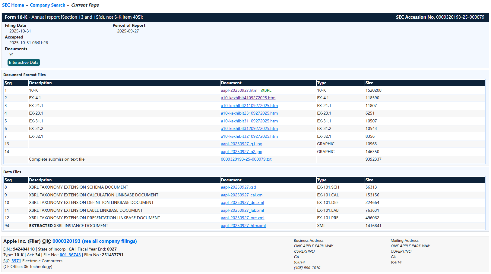
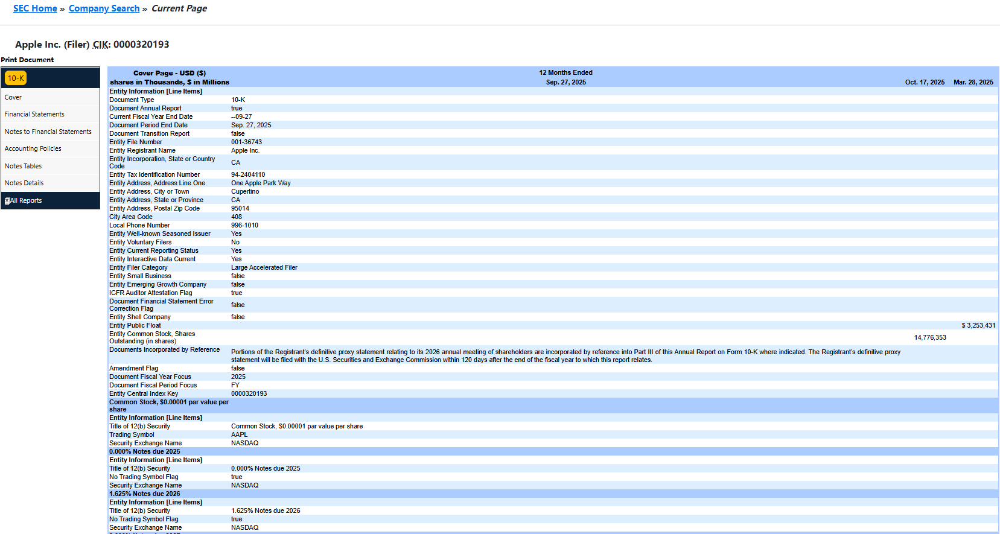

# 第13章 数据资源 第3节 EDGAR 系统 {.unnumbered}

## 一、EDGAR 系统概述 {.unnumbered}

EDGAR 是美国证券交易委员会（SEC）运营的一套核心电子系统，全称为 **电子数据收集、分析和检索系统**（Electronic Data Gathering, Analysis, and Retrieval system）。

### 1.核心定义与功能

EDGAR 是上市公司、共同基金等实体依法向 SEC 提交官方文件的主要电子门户。它并非一个简单的文件存储库，而是一个执行自动化流程的系统，负责对提交的文件进行收集、验证、索引、接收和转发。

EDGAR 连接着两个主要的群体：

-   **提交方（Filers）**：在美国，所有本土和外国上市公司都被要求通过 EDGAR 以电子方式提交注册声明、定期报告（如 10-K 年报）及其他重要表格。自1996年起，绝大多数上市公司的文件提交已强制通过该系统进行。
-   **查阅方（Users）**：**公众可以免费访问** EDGAR 的公开数据库。投资者、分析师或任何感兴趣的人都可以在这里研究一家上市公司的财务信息、运营状况，以及共同基金、ETF 等产品的披露文件。

EDGAR 是维持美国证券市场透明度的基石。它通过加速重要公司信息的接收与传播，提升了市场的效率、透明度和公平性，从而惠及投资者、企业和整体经济。

其数据规模也反映了它的核心地位：EDGAR 平均每天处理约 4,700 份文件，每年向公众提供高达 3,000 TB 的数据，并平均容纳 40,000 名新提交者。

EDGAR 是美国证券监管体系数字化基础设施的核心，是获取在美上市企业官方披露信息最权威、最直接的公开渠道。

### 2.提交方法和案例

以一家美国上市公司提交 10-K 年报为例，通过 EDGAR 提交文件并非简单地上传一个文档，而是一套涉及身份认证、格式规范和系统操作的标准流程。

#### 2.1.第一步：获取“数字身份证”——申请 EDGAR 访问权限

在提交任何文件之前，公司必须先获得在 EDGAR 系统内的“户口”。对于首次进行电子申报的公司，核心步骤是提交 Form ID 来申请 EDGAR 访问代码（即 CIK 账号和密码）。

具体操作是：公司的授权人员需要在 EDGAR Filer Management 门户 上在线填写并提交 Form ID 申请。提交后，还需将填写好的表格打印出来，由公司的授权代表在公证人面前签字进行公证，最后将这份经过公证的认证文件上传回系统，以完成身份核验。

#### 2.2.第二步：登录专用门户，准备提交

获得访问权限后，正式的提交操作通常在 EDGAR Filing 门户 上进行。提交人需要使用自己的个人账户凭证（通常与 Login.gov 账户关联）登录，并完成多因素认证。

登录后，操作者需要输入公司的 CIK 号码（EDGAR 系统中的唯一识别码），以确保文件被归入正确的公司档案下。

#### 2.3.第三步：组装并提交 10-K 文件

这是最核心的环节。10-K 年报的内容复杂，包含财务报表、管理层讨论、风险因素等，且必须遵循 EDGAR Filer Manual 规定的严格技术格式要求（例如，财务数据常需使用 XBRL 格式）。

在实际操作中，许多公司（尤其是大型公司）会借助财务打印商或专业申报代理的服务来组装和传输文件，以确保格式合规并避免技术错误。一切就绪后，提交人通过 Filing 门户上传组装好的 10-K 文件包，完成正式提交。

#### 2.4.提交文件种类

通过 EDGAR 提交的文件种类繁多，以下是几个常见文件类型的真实提交示例：

-   **10-K 年报**：**Ranpak Holdings Corp.** 就曾通过 EDGAR 提交了其截至2025年12月31日财年的 10-K 年报。这是上市公司每年必须履行的核心披露义务。
-   **8-K 临时报告**：当发生需要及时向市场公告的重大事件时，公司会提交 8-K。例如，**Moleculin Biotech, Inc.** 在2026年10月16日提交了一份 8-K，披露其使用了新的公司演示文稿这一信息。
-   **S-1 注册声明**：这是公司计划进行首次公开募股（IPO）时提交的“招股书”文件。例如，**Amaze Holdings, Inc.** 于2026年10月16日通过 EDGAR 提交了其 S-1 注册声明。

#### 2.5.关键操作提醒

-   **提交时间窗口**：EDGAR 系统在工作日（联邦假日除外）的**东部时间早上6点至晚上10点**接受提交。在此窗口外提交的文件，将被视为在下一个工作日处理。
-   **账户角色管理**：现代 EDGAR 系统（EDGAR Next）强调账户的角色分工。公司可以指定**账户管理员**来管理账户，并邀请其他个人作为“用户”或“技术管理员”来执行具体的提交操作，实现了权限的分离与制衡。

总结来说，通过 EDGAR 提交文件是一个将线下准备、法定认证与线上系统操作相结合的标准流程，其核心在于通过严格的账户管理和格式规范，确保向市场披露信息的权威性与一致性。

## 二、美国上市公司提交表格种类

### 1. 财务信息与经营成果

美国国内上市公司需提交年度报告、季度报告，以及在发生需要及时披露的特定事件时提交临时报告。年报和季报均包含相关期间的财务报表。

| 表格类型 | 说明 |
|------------------------------------|------------------------------------|
| 10-K | 年度报告——提供经审计的年度财务报表、公司及其业务的重大风险因素讨论，以及管理层对上一财年经营成果的讨论与分析。 |
| 10-Q | 季度报告——提供未经审计的季度财务报表、公司面临的重大风险更新，以及管理层对上一财季经营成果的讨论与分析。 |
| 8-K | 临时报告——披露公司在下次定期季报或年报之前选择或按要求公开的重大事件或信息。 |

部分公司目前（且即将所有公司都必须）以 Inline XBRL 结构化数据格式提交含财务信息的披露报告，EDGAR 已集成相关工具以方便用户利用这些信息。

### 2. 股东大会

受 SEC 委托书规则约束的上市公司、共同基金和 ETF 会向股东发送委托书（proxy statement），以征求其在股东大会上的投票。委托书描述会议将表决的事项，并可能包含公司或基金董事会及高管薪酬等信息。此类委托书可在 EDGAR 上查到。

| 表格类型 | 说明                                                       |
|----------|------------------------------------------------------------|
| PRE 14A  | 初步委托书——须经 SEC 工作人员审查的初步委托书。            |
| DEF 14A  | 最终委托书——与股东大会相关的、发送给公司股东的最终委托书。 |

### 3. 高管薪酬

美国国内上市公司定期披露首席执行官及其他高薪高管的薪酬，并说明其高管和董事会薪酬政策。

| 表格类型 | 说明 |
|------------------------------------|------------------------------------|
| DEF 14A | 受委托书规则约束的公司通常会在年度委托书中提供详细的薪酬披露，包括薪酬讨论与分析部分。 |
| 10-K | 若委托书中未包含薪酬披露，或公司未提交委托书，则 10-K 年度报告应包含该披露。 |
| 8-K | 某些高管薪酬的变更须根据该报告第 5.02 项披露。EDGAR 对 8-K 表格报告的搜索结果会显示每份报告包含的项目编号。 |

### 4. 内部人交易

公司内部人——高管、董事以及持有公司某类注册股权证券超过 10% 的持有人——必须定期披露其在该公司所有股权证券中的持股和交易情况。

| 表格类型 | 说明                                                             |
|-----------------|-------------------------------------------------------|
| 3        | 受益所有权初始声明——公司股权证券持股的初始声明。                 |
| 4        | 受益所有权变更声明——在交易后两个营业日内披露公司股权证券的交易。 |
| 5        | 受益所有权年度声明——公司股权证券持股的年度声明。                 |

### 5. 受益所有权权益

任何个人或团体如取得某上市公司某类注册有表决权证券超过 5% 的受益所有权，必须披露其持股。此外，公司会定期披露其主要股东，机构投资管理人（如共同基金、对冲基金或养老金的管理人）也会定期披露其持股。

| 表格类型 | 说明 |
|------------------------------------|------------------------------------|
| Schedule 13D | 当一方取得某公司某类注册有表决权证券超过 5% 时提交；也用于披露其后的持股变更。 |
| Schedule 13G | 当一方以被动投资方式取得某公司某类注册有表决权证券超过 5% 时提交。 |
| DEF 14A | 公司须在此披露其董事和高管受益拥有的股权证券数量，以及任何受益拥有公司某类有表决权证券超过 5% 的个人或团体。 |
| 13F | 机构投资管理人报告——机构投资管理人按季度披露其持股及持股变更。 |

### 6. 企业合并

根据并购交易的结构不同，交易涉及的公司可能需要提交不同类型的备案。与企业合并相关的常见表格类型包括：

| 表格类型 | 说明 |
|------------------------------------|------------------------------------|
| PREM14A | 与并购相关的初步委托书——须经 SEC 工作人员审查的初步委托书。 |
| DEFM14A | 与并购相关的最终委托书——发送给公司股东的最终委托书，包含交易条款及交易理由的讨论。 |
| S-4 | 注册声明——当公司注册拟作为并购对价使用的证券时提交。注册声明通常并入发送给股东的任何委托书。 |
| 425 | 招股说明书与通讯——证券作为部分对价的企业合并相关的书面披露和通讯。 |
| SC TO-T / SC TO-I | 第三方/发行人要约收购声明——由拟向公众公司股东购买其流通股的当事方提交。发送给股东的披露文件通常作为附件提交。 |
| SC 14D-9 | 要约收购征求/建议声明——须披露目标公司对要约收购建议的备案。 |
| 8-K | 企业合并的某些信息可能在 8-K 表格中披露，例如合并协议首次签署，或收购无需股东批准时有关被收购公司的信息。 |

### 7. 公开发行

公司须向 SEC 提交注册声明，以注册向公众的要约和销售证券。公司首次公开发行并销售证券称为首次公开募股（IPO）。招股说明书（prospectus）通常是注册声明的很大一部分，是提供给投资者、披露公司和发行信息的文件。

| 表格类型 | 说明 |
|------------------------------------|------------------------------------|
| S-1 | 注册声明——为注册向公众的要约和销售证券而提交，通常与首次公开募股相关。 |
| S-3 | 简式注册声明——某些已报告公司可使用的简化注册声明，用于注册向公众的要约和销售证券。 |
| 424B\[#\] | 招股说明书——披露公司和发行信息、通常构成注册声明很大一部分的文件。 |
| UPLOAD | SEC 函件——SEC 工作人员在审查过程中（包括对 IPO 注册声明的审查）向公司发出的公开书面函件。 |
| CORRESP | 函件——公司及其顾问在审查过程中向 SEC 工作人员发出的公开函件。 |

### 8. 证券型众筹

众筹是从大量人群的小额个人投资或出资中筹集资金的方式。依据证券型众筹注册豁免向公众要约和销售证券的公司必须在 EDGAR 上提交备案。

| 表格类型 | 说明 |
|------------------------------------|------------------------------------|
| C | 发行声明——众筹发行公司作出的披露，包含公司自身及发行信息。 |
| C-U | 进展更新——发行期间关于是否达到目标发行金额的进展披露（除非中介机构在其在线平台提供更新）以及最终售出证券金额。 |
| C-AR | 年度报告——公司年度报告，包含财务报表。 |
| C-TR | 终止报告——如符合条件，公司终止其年度报告提交义务的备案。 |

### 9. Regulation A 发行

Regulation A 允许符合条件的公司在 12 个月内筹集不超过 5,000 万美元，以比注册证券发行要求更有限的披露向公众要约证券。进行 Regulation A 发行的公司根据拟筹资金额适用 Tier 1 或 Tier 2 要求。Tier 1 发行公司除提交披露发行终止或完成的最终报告外，无持续报告义务；Tier 2 发行公司则有持续报告义务。

| 表格类型 | 说明 |
|------------------------------------|------------------------------------|
| 1-A | 发行声明——包含发行通函（offering circular），即提供给投资者、提供公司和发行重要披露的文件。 |
| 1-Z | 退出报告——详述发行的终止或完成。Tier 2 公司可在 1-K 表格中披露此信息。 |

**Tier 2 公司的持续报告**

| 表格类型 | 说明 |
|------------------------------------|------------------------------------|
| 1-K | 年度报告——包含经审计财务报表及公司年度财务成果讨论。 |
| 1-SA | 半年度报告——包含公司财年上半年未经审计的中期财务报表及该期间财务成果讨论。 |
| 1-U | 临时报告——披露特定事件，包括根本性变更、破产、会计师变更、不再依赖先前财务报表或审计报告、控制权变更以及主要高管离职。 |

### 10. 外国私人发行人

部分在美国境外组织或设立的公司（联邦证券法下称为外国私人发行人）可能以不同于美国上市公司的表格向 SEC 提交报告。

| 表格类型 | 说明 |
|------------------------------------|------------------------------------|
| F-1 | 注册声明——外国私人发行人可选择以此备案注册证券发行。 |
| 20-F | 年度报告或注册声明——包含外国私人发行人经审计财务报表及公司财务成果讨论。封面页的复选框指示该备案是年度报告还是注册某类证券。 |
| 6-K | 报告——与新闻稿、致证券持有人通讯以及公司母国法律要求向证券持有人作出的任何披露相关而提交。 |

### 11. 共同基金与 ETF

共同基金和 ETF 在 EDGAR 上提交的部分备案与上市公司相同或类似，也有一些不同的表格，其中部分仅由货币市场基金提交。请注意基金可能名称相似，为确保查看的是正确的基金，请核对搜索结果页面上的股票代码。除 EDGAR 外，通常也可从基金网站或您的理财专业人士处获取这些文件。

| 表格类型 | 说明 |
|------------------------------------|------------------------------------|
| N-1A/485 | 注册声明（含招股说明书）——招股说明书包含基金信息，如投资目标/目的、费用表、投资策略与风险及业绩、顾问与投资组合经理、基金份额的购买与赎回以及税务信息。 |
| 497K | 摘要招股说明书——摘要披露文件，包含完整招股说明书开头所需的相同关键信息。 |
| 497 | 基金招股说明书定期更新——包含招股说明书的定期更新。 |
| N-CSR / N-CSRS | 年度/半年度股东报告——描述基金运作情况，包含基金持仓和财务报表。年度报告还讨论上一财年对基金业绩产生重大影响的市场状况和投资策略。 |
| DEF 14A | 最终委托书——就基金股东大会上将表决的事项发送的委托书。 |
| N-PX | 委托投票记录——列明基金有权对其底层投资组合持仓投票的具体提案以及基金对每项提案的投票方式。 |
| N-PORT | N-PORT 附件中的投资组合持仓明细——包含基金第一和第三财季（未在 N-CSR 表格中报告）的投资组合持仓清单。 |
| N-14 | 基金合并注册声明——披露文件包含基金合并或其他类似交易的信息。 |

### 12. 可变年金

可变年金的许多备案与共同基金和 ETF 相同或类似。为获得最佳结果，请按可变年金合同的营销名称搜索。请注意保险公司及其合同可能名称相似，为确保查看的是正确的可变年金，请核对合同名称和保险公司名称。除 EDGAR 外，通常也可从保险公司网站或您的理财专业人士处获取这些文件。

| 表格类型 | 说明 |
|------------------------------------|------------------------------------|
| N-4/485 | 注册声明（含招股说明书）——招股说明书包含可变年金信息，如费用、投资选项以及保险特征（如身故保险金或收入保障）。 |
| 497 | 可变年金招股说明书定期更新——包含招股说明书的定期更新。 |

### 13.附件（Exhibits）

备案中通常要求附上附件，可包括重大协议、组织文件（如公司章程）、财务报表和演示材料。附件清单可在备案文件末尾附近的附件索引（exhibit index）中找到，上市公司现在须为所列每份附件包含超链接。附件可能与备案同时提交，也可能此前已提交。若附件随先前版本的备案提交，通常会有注明表明该附件此前已提交；若附件随完全不同的另一份备案提交，附件索引通常会注明该附件通过引用并入（incorporated by reference）。附件索引示例：

| 编号 | 说明 |
|------------------------------------|------------------------------------|
| 3.1 | 公司章程（通过引用并入公司 2012 年 1 月 2 日提交的 S-1 表格注册声明附件 3.1）——该附件可在所引用的先前备案中找到。 |
| 3.2 | 修订与重述的公司章程\*——如标注所示，该附件已在当前备案的较早版本中提交。 |
| 10.1 | 公司与 Big Bank 于 2018 年 1 月 30 日签订的贷款协议——该附件随当前备案提交。 |

: \* 此前已提交。

EDGAR 对查阅方而言，核心价值在于免费、权威、可追溯。它不是一个为终端投资者设计的“漂亮界面”，而是一套以原始披露文件为单位的数据库。查阅方能否高效利用它，取决于是否理解它的检索逻辑和边界。

## 三、EDGAR 查询

### 1.入口

EDGAR 的公开查阅入口没有单一门户，而是按用途分散在 SEC 官网的不同位置：

-   **首页快捷搜索**：在 SEC.gov 首页（[SEC.gov \| Home](https://www.sec.gov/)）搜索栏直接输入**公司名称或股票代码**，即可进入对应公司的 filing 列表。
-   **Company Search（公司搜索）** ：最常用的检索页面（[SEC.gov \| Search Filings](https://www.sec.gov/search-filings)），可按公司名称、股票代码或 CIK 编号查找，结果按日期倒序列出该公司全部 filing。
-   **Full-Text Search（全文检索）** ：独立于公司搜索，用于在 filing **正文和附件**中查找关键词，详见下文。
-   **基金专用入口**：查找共同基金或 ETF 时，需从首页进入 Company Filings，再使用左侧的 **Mutual Funds** 工具；ETF 也通过这一入口检索（[SEC.gov \| Mutual Funds Search](https://www.sec.gov/search-filings/mutual-funds-search)）。

**CIK（Central Index Key）** 是 EDGAR 内部识别实体的唯一数字编号。当公司名称存在歧义（如子公司、曾用名）时，用 CIK 检索最为精准。

### 2.核心检索工具

#### 普通搜索 vs. 全文检索

这是查阅方最需要分清的一组工具。

|   | 普通搜索 / Company Search | Full-Text Search |
|:-----------------------|:-----------------------|:-----------------------|
| **检索对象** | 公司**元数据**：名称、代码、CIK、filing 类型、日期 | filing 的**正文与附件全文** |
| **时间范围** | 覆盖该公司全部历史 filing | **2001 年至今**提交的 electronic filings |
| **典型用途** | “这家公司过去五年提交过哪些 10-K？” | “哪些公司的 filing 里提到过‘某产品’或‘某风险因素’？” |

全文检索支持布尔逻辑：默认所有输入词都必须出现（AND）；用 `OR` 连接可放宽条件；用 `NOT` 或 `-` 前缀排除；`NEAR(n)` 可限定两个词之间的最大间隔词数。通配符 `*` 可用于词根检索（如 `gas*` 匹配 gas、gasoline），但不能用在词首或精确短语中。高级搜索选项（More Search Options）允许进一步按 form type、日期区间、公司等条件收窄结果。

一个关键局限：全文检索不支持自然语言搜索，必须使用关键词和逻辑运算符构造查询。

### 3.按实体类型查阅

#### 3.1.上市公司

公司 filing 列表按时间倒序排列，**form type 是第一列**。读懂 form type 是快速定位信息的前提：

-   **10-K / 10-K/A**：年报及其修正案，包含经审计财务数据、MD&A、风险因素。
-   **10-Q**：季报，覆盖财年前三个季度，未经审计。
-   **8-K**：重大事件临时报告，通常在事件发生后 **4 个工作日**内提交。
-   **DEF 14A**：股东大会前的代理声明，涉及董事选举、高管薪酬等治理信息。
-   **Form 4**：内部人（董事、高管、10% 以上股东）持股变动的 **2 个工作日**内披露。

当一家公司提交了 **10-K/A** 时，意味着原 10-K 存在需要修正的内容，查阅时应以修正后的版本为准。

#### 3.2.共同基金与 ETF

基金类产品的披露逻辑与上市公司不同，需要通过 **Mutual Funds 工具**进入。查阅方通常关注以下几类文件：

-   **N-PORT**：月度投资组合报告，是查看 ETF **实际持仓**的核心文件，可按总资产、持仓标的代码、月度回报等参数检索。
-   **485BPOS**：基金注册声明的生效后修正案，涉及新基金设立或现有基金的重大变更。
-   **N-CSR**：基金年度/半年度股东报告。

基金检索的一个复杂之处在于**系列（series）和类别（class）** 的多层结构：同一信托（trust）之下可能有多只基金，每只基金又有不同的份额类别。EDGAR 的检索结果会以系列 ID 和类别 ID 区分，需要留意所查文件对应的具体层级。

#### 3.3.获取数据

如果查阅目的不止于阅读单份 PDF/HTML，EDGAR 提供了更结构化的数据获取路径。

**Inline XBRL Viewer** 嵌入在 filing 的 HTML 页面中。财务数据在 filing 中被标记为 XBRL 标签，使用 Viewer 可以**直接点击报表中的数字**，查看其在后续 filing 中的连续变化、对应标签和上下文信息，而不必手动从多个文档中摘录比对。

**XBRL（eXtensible Business Reporting Language，可扩展商业报告语言）**是一种用于商业和财务报告电子化交换的**开放国际标准**。简单来说，它就像给财务报告中的每一个数据（如“净利润”“总资产”）贴上计算机能读懂的“条形码”标签，让机器可以自动抓取、分析和比较这些数据。

**data.sec.gov 的 RESTful API** 提供 JSON 格式的提交历史和 XBRL 财务数据，**无需 API 密钥**即可访问。核心端点包括：

-   `data.sec.gov/submissions/CIK##########.json`：某实体的 filing 历史元数据。
-   `data.sec.gov/api/xbrl/companyconcept/...`：单家公司、单一 XBRL 概念的多期数据。

另有**批量 ZIP 文件**每日凌晨约 3:00 ET 更新，适合需要全量数据的研究场景。

对于批量或脚本化访问，SEC 要求遵守 **Fair Access** 原则：声明 User-Agent、限制请求频率，避免对公共基础设施造成负担。

### 4.查阅方必须知道的信息边界

EDGAR 的权威性来自它的**强制性**：只有依法必须向 SEC 提交文件的实体才会出现在这里。这同时决定了它的边界：

-   **不覆盖非 SEC 注册实体。** 私人公司、大多数场外交易（OTC）公司（尤其是 Pink Sheets 层级）**没有**向 EDGAR 提交定期报告的义务。对这些公司的信息，EDGAR 可能只有零星的 **Form D**（豁免发行通知），而 Form D 不包含经审计财务报表或持续经营信息。如果需要研究私人公司，需要转向商业数据库、州务卿注册记录或其他替代来源。

-   **场外和固定收益交易数据存在结构性盲区。** EDGAR 披露的是**发行人层面**的信息，而不是**交易层面**的数据。场外交易、固定收益市场的成交信息在 EDGAR 中只有“碎片化覆盖”，公开股票的交易虽最终会被报告，但时效性和完整性都有限。

-   **披露时点不等于信息生成时点。** EDGAR 记录的是 filing **被系统接收的时间**。从信息形成到文件上传之间存在时滞，学术研究曾记录过 pre-EDGAR 时代长达数周的分发延迟；即便在 EDGAR 时代，filing 到达网站与 FTP 时间戳之间仍可能存在数十秒量级的随机延迟。对于高频交易或事件驱动策略，这一时滞需要纳入考量。

### 5.总结

EDGAR 对查阅方的意义，在于它提供的是一个未经二次加工的、可程序化访问的原始披露池。它的效率不来自界面，而来自你对 form type 体系、全文检索语法、CIK 定位、XBRL/API 结构化数据的熟练运用；它的边界同样清晰——强制披露的对象范围和交易层面数据的缺失，决定了它适合研究“发行人说了什么”，而不适合替代交易数据或私人公司研究工具。

## 四、EDGAR 查询案例

我们以获取 Apple Inc. 最新年度 10-K（FY2025，财年截止 2025 年 9 月 27 日，于 2025 年 10 月 31 日提交） 为例，分手动查阅与程序化获取两条路径说明具体操作。

### 1.确认关键定位信息

在 EDGAR 中精准定位 Apple 的文件，需要记住四个标识：

-   **CIK**：`0000320193`（Apple 在 EDGAR 中的唯一编号，用 CIK 检索比用公司名更精确）
-   **Form type**：`10-K`
-   **最新一份的 Filing Date**：`2025-10-31`
-   **Accession Number**：`0000320193-25-000079`（该份 10-K 在 EDGAR 中的唯一文件编号）

如果只记得股票代码，EDGAR 的公司搜索也支持直接输入 `AAPL`，系统会自动解析到 CIK 320193。

### 2.路径一：手动查阅

#### 2.1.第 1 步：进入 Apple 的 EDGAR 公司页面

打开浏览器，访问 EDGAR 的公司搜索入口：

```         
https://www.sec.gov/edgar/browse/?CIK=320193
```

或直接使用 Apple 的 CIK 拼接：

```         
https://www.sec.gov/cgi-bin/browse-edgar?action=getcompany&CIK=0000320193&type=10-K
```

第二个链接会直接过滤出 Apple 历史上所有的 10-K 文件，按日期倒序排列。最新一条即 2025-10-31 提交的 FY2025 年报。

#### 2.2.第 2 步：打开文件

在 filings 列表中，每条记录通常提供两个入口：

**Documents**：进入该次提交的**文件索引页**，列出本次提交包含的全部文件（主文档、XBRL 附件、 Exhibit 等）。



**interactive Data**：进入该 filing 的 **index 页面**，展示提交元数据（CIK、form type、period of report、文件编号等），并提供**主 10-K 文档**的链接。



#### 2.3.第 3 步：Inline XBRL Viewer

Apple 的 10-K 主文档是以 **Inline XBRL** 格式提交的。这意味着文档中每一个被标记的财务数字都嵌入了结构化的 XBRL 标签。SEC 在 HTML 页面中内置了 **Inline XBRL Viewer**，打开主文档后，你可以：

-   将鼠标悬停在任何一个有 XBRL 标签的数字上，页面会自动为该数字加上**上下高亮边框**，表明这是一个结构化事实。
-   点击该数字，Viewer 会弹出侧栏，显示这个数字对应的 **XBRL 标签名**（如 `RevenueFromContractWithCustomerExcludingAssessedTax`）、所属 taxonomy、报告期间、单位，以及它在历史 filing 中的连续数值。

这意味着，在 10-K 的**合并利润表**或**合并资产负债表**中，你无需手动摘录或跨文件比对，点击“Total net sales”或“Net income”就可以直接看到该概念在多期的序列。

### 3.路径二：程序化获取

如果需要把数据导入 Excel、Python 或数据库，手动点击效率太低。SEC 在 `data.sec.gov` 提供了**无需 API Key** 的 JSON API，数据直接来源于 XBRL 标签，跳过 HTML 解析。

#### 3.1.端点选择：companyconcept vs. companyfacts

| 端点 | 返回内容 | 适用场景 |
|:-----------------------|:-----------------------|:-----------------------|
| `companyconcept` | **单一概念**在所有报告期的全部数值 | 只取收入、净利润等少数指标 |
| `companyfacts` | 该公司**全部 XBRL 概念**的一次性全量返回 | 需要批量提取多张报表 |

对于“获取最新年报中的财务数据”，**`companyconcept` 最直接**。例如，获取 Apple 收入数据的端点：

```         
https://data.sec.gov/api/xbrl/companyconcept/CIK0000320193/us-gaap/Revenues.json
```

返回的 JSON 中，`units.USD` 数组包含了从 2016 年至今每一期的收入数值，每条记录带有 `form`（10-K / 10-Q）、`fy`（财年）、`fp`（财季）、`filed`（提交日期）等元数据。筛选 `form == "10-K"` 且 `fy == 2025` 的记录，即可定位到 FY2025 的年度收入。

**但要注意一个常见陷阱**：Apple 近年实际使用的收入标签并非 `Revenues`，而是 `RevenueFromContractWithCustomerExcludingAssessedTax`。如果你的请求对 `Revenues` 返回不完整或较旧的数据，应改用这个更具体的标签。净利润的常用标签则是 `NetIncomeLoss`。

#### 3.2.简单示例

下面是一个 R 脚本，读取你提供的 JSON 文件并转换为 `data.frame`。运行后你会得到一个 11 行的 data.frame，列包括 `cik, taxonomy, tag, label, entityName, start, end, val, accn, fy, fp, form, filed, frame`。

``` r
library(jsonlite)
library(httr)

url <- "https://data.sec.gov/api/xbrl/companyconcept/CIK0000320193/us-gaap/Revenues.json"

resp <- GET(url, add_headers(`User-Agent` = "Your Name your.email@example.com"))

# SEC 要求带 User-Agent（填你的名字/邮箱）

raw <- fromJSON(content(resp, "text", encoding = "UTF-8"), simplifyVector = FALSE)

# 提取 USD 单位下的记录
usd <- raw$units$USD

df <- do.call(rbind, lapply(usd, function(x) {
  data.frame(
    cik        = raw$cik,
    taxonomy   = raw$taxonomy,
    tag        = raw$tag,
    label      = raw$label,
    entityName = raw$entityName,
    start      = x$start,
    end        = x$end,
    val        = x$val,
    accn       = x$accn,
    fy         = x$fy,
    fp         = x$fp,
    form       = x$form,
    filed      = x$filed,
    frame      = if (!is.null(x$frame)) x$frame else NA_character_,
    stringsAsFactors = FALSE
  )
}))
```

python代码示例如下：

``` python
import requests

headers = {
    "User-Agent": "YourName your-email@example.com"  # SEC 强制要求声明身份
}

# 获取 Apple FY2025 收入（使用公司实际使用的标签）
url = (
    "https://data.sec.gov/api/xbrl/companyconcept/"
    "CIK0000320193/us-gaap/RevenueFromContractWithCustomerExcludingAssessedTax.json"
)
r = requests.get(url, headers=headers)
data = r.json()

usd = data["units"]["USD"]
fy2025 = [
    f for f in usd
    if f.get("form") == "10-K" and f.get("fy") == 2025 and f.get("fp") == "FY"
]

for f in fy2025:
    print(f"期间: {f['start']} → {f['end']}")
    print(f"收入: ${f['val']:,} 美元")
    print(f"accession: {f['accn']}")
    
```

**注意**：

-   **`User-Agent` 必须包含**。SEC 将匿名请求视为对公共基础设施的不当使用，会限流或拒绝。格式建议为 `“应用名/版本 联系邮箱”`，例如 `“my-research/1.0 me@example.com”`。
-   全局限速约为 **10 请求/秒**，个人研究场景通常不会触及，但批量脚本需要留意。
-   **财年 ≠ 日历年**。Apple 的 FY2025 截止于 2025 年 9 月 27 日，与自然年不一致。用 `fy` 筛选时，取的是 Apple 自己定义的财年标记，不是日期区间。

**如果你只需要看 Apple 年报中的几个核心数字**，路径一（浏览器 + Inline XBRL Viewer）最快，点击即见，还能看到上下文。**如果你需要把这些数字放入持续更新的模型、对比表或数据库中**，路径二的 `companyconcept` 端点更可靠，因为它返回的是 company 自己用 XBRL 标签“盖章”过的数值，不经过第三方录入或解析。

一个需要留意的细节：EDGAR 中存在**修正 filing**（如 10-K/A）时，同一财年可能出现多个版本。程序化取数时应以 `filed` 日期最新的记录为准；手动查阅时，index 页面上 filing type 显示为 `10-K/A` 的文件才代表修正案，而非新的年度报告。

## 五、获取财务数据完整案例（R 语言）

用 R 语言从 EDGAR 获的财务数据，主要有三种路径，从“开箱即用”到“完全掌控”各有侧重。核心思路依然是直接利用 SEC 官方的 **`data.sec.gov` XBRL API**，因为这是最结构化、最稳定的数据源。

### 1.路径一：`edgarfundamentals` 包

这个包专门为“拉取最新 10-K 核心财务数据”设计，用股票代码（ticker）就能直接返回关键指标，无需手动处理 API 细节。

**安装与配置**

``` r
install.packages("edgarfundamentals")

library(edgarfundamentals)

# SEC 要求所有自动化请求声明身份，否则会被限流
options(edgarfundamentals.user_agent = "Your Name your@email.com")
```

**获取苹果最新年报数据**

``` r
# 默认返回最近一份 10-K 中的关键财务比率和数据
aapl_data <- get_fundamentals("AAPL", to_date = "2025-12-31")
print(aapl_data)
```

`get_fundamentals()` 返回的内容包括 **EPS、净利润（NetIncome）、总收入（Revenue）、ROE、ROA、负债权益比、毛利率、营业利润率、净利率** 等，数据直接来源于 EDGAR 的 XBRL API，覆盖最近一个完整财年的 10-K 文件。`to_date` 参数用于指定“在此日期之前最近一份已完成的年报”，并非严格的截止日期。

如果你想同时拉取多只股票的数据，可以使用 `get_fundamentals_batch(c("AAPL", "MSFT", ...))`。

### 2.路径二：`httr` + `jsonlite` 包

如果需要**精确控制取哪个指标、哪个财年**，或者需要原始的多期时间序列（而不仅仅是单一快照），直接调用 API 是更好的选择。核心是 `companyconcept` 端点，它返回**某一个 XBRL 概念在所有报告期的全部数值**。

**加载必要的包**

``` r
library(httr)
library(jsonlite)
library(dplyr)  # 用于后续筛选
```

**构建请求并获取收入数据**

苹果公司实际使用的收入标签是 `RevenueFromContractWithCustomerExcludingAssessedTax`，而非通用的 `Revenues`。CIK 为 `0000320193`。

``` r
# 1. 定义请求
url <- paste0(
  "https://data.sec.gov/api/xbrl/companyconcept/",
  "CIK0000320193/us-gaap/",
  "RevenueFromContractWithCustomerExcludingAssessedTax.json"
)

# 2. 发送请求，必须携带 User-Agent 头
resp <- GET(url, add_headers("User-Agent" = "Your Name your@email.com"))

# 3. 解析 JSON
raw_data <- fromJSON(content(resp, "text", encoding = "UTF-8"), flatten = TRUE)
```

**从返回结构中提取 FY2025 年度收入**

API 返回的 `raw_data$units$USD` 是一个数据框，包含所有报告期（10-K 年度 + 10-Q 季度）的记录。筛选 `form == "10-K"` 且 `fy == 2025` 且 `fp == "FY"` 即可定位年度数据。

``` r
usd_data <- raw_data$units$USD

aapl_rev_fy2025 <- usd_data %>%
  filter(form == "10-K", fy == 2025, fp == "FY") %>%
  select(start, end, val, accn, filed) %>%
  arrange(desc(filed))  # 按提交日期降序，取最新一份

print(aapl_rev_fy2025)
```

**净利润同理**，只需将 URL 中的标签换成 `NetIncomeLoss`：

``` r
url_ni <- paste0(
  "https://data.sec.gov/api/xbrl/companyconcept/",
  "CIK0000320193/us-gaap/NetIncomeLoss.json"
)
# 后续请求、解析、筛选步骤完全一致
```

**路径二的要点**：`companyconcept` 返回的是**多期序列**，你可以在一次请求中拿到苹果过去多年的收入或净利润，便于直接在 R 中绘制趋势图或进行时间序列分析。全局限速约 **10 请求/秒**，个人使用通常不会触及。

### 3.路径三：`edgarWebR` 包

如果你需要**先拿到苹果所有 10-K 的文件链接**（例如，想批量下载原始 HTML 或 XML 文件），`edgarWebR` 包可以快速完成这一步。

``` r
# install.packages("edgarWebR")
library(edgarWebR)

# 获取苹果历史上所有 10-K 提交的列表
aapl_10ks <- company_filings("0000320193", type = "10-K", page = 1000)

# 查看最新的 10-K 记录及其链接
head(aapl_10ks[, c("filing_date", "href")], 1)
```

返回的数据框中，`href` 字段是每一份 10-K 在 SEC 网站上的索引页链接。拿到链接后，可以进一步用 `XBRL` 包解析原始的 XBRL 实例文档，或者在浏览器中打开查看。

### 4.选择建议

| 需求场景 | 推荐路径 |
|:-----------------------------------|:-----------------------------------|
| 快速拿到苹果最新年报的 EPS、收入、净利润等**核心快照** | **路径一** `edgarfundamentals` |
| 需要**多期时间序列**（例如过去 5-10 年的收入），用于建模或绘图 | **路径二** `httr` + `jsonlite` + `companyconcept` |
| 需要**批量下载原始文件**（HTML/XBRL 实例）进行深度解析 | **路径三** `edgarWebR` 获取链接，再配合 `XBRL` 包 |

**注意：**无论哪条路径，`User-Agent` 声明都是必须的。SEC 将未声明身份的自动化请求视为对公共基础设施的不当使用，可能导致请求被拒绝或限流。

实践中，最好的做法是将 User-Agent 写入项目根目录的 `.Renviron` 文件，`SEC_EDGAR_USER_AGENT="Your Name email@example.com"`，然后用 `Sys.getenv("SEC_EDGAR_USER_AGENT")` 读取，避免将个人信息硬编码在脚本中。

## 六、`edgarfundamentals` 包

`edgarfundamentals` 是一个设计思路非常明确的 R 包。它的目标不是做一个大而全的 EDGAR 客户端，而是将“从最新 10-K 中提取一组核心财务比率”这个高频、重复的动作，压缩成一行代码。

### 1.核心定位和功能

这个包的作者 Robert P. Schumaker 将其定位为面向**量化金融教学和研究工作流**的工具。它不试图覆盖 EDGAR 的所有功能，而是通过一个极简的 ticker 驱动接口，直接返回**任何美国上市公司最近一份 10-K 年报中的关键财务比率**。

你不需要手动拼接 CIK、查找 Accession Number、解析 XBRL 标签，也不需要处理不同公司可能使用不同标签（如 `Revenues` vs. `RevenueFromContractWithCustomerExcludingAssessedTax`）的麻烦。输入 `"AAPL"`，输出的是一组已经计算好的、可直接用于筛选或建模的指标。

### 2.安装与配置

包已发布在 CRAN 上，直接从官方仓库安装即可。

``` r
install.packages("edgarfundamentals")
```

在使用任何函数之前，**必须设置一次 User-Agent**。这不是这个包的额外要求，而是 SEC 对所有自动化访问其公共 API 的强制规定。包通过一个 R option 来接收这个信息：

``` r
library(edgarfundamentals)

options(edgarfundamentals.user_agent = "Your Name your@email.com")
```

设置后，包在内部发起 HTTP 请求时会自动携带该标识，你无需在每次调用时重复处理。

### 3.核心函数

包的功能高度收敛，主要围绕以下四个函数展开。

| 函数 | 作用 | 关键参数 |
|:-----------------------|:-----------------------|:-----------------------|
| **`get_cik(symbol)`** | 将**股票代码**翻译为 SEC 的 **CIK 编号** | `symbol`：如 `"AAPL"`，大小写不敏感 |
| **`get_fundamentals(symbol, to_date)`** | 获取**单只股票**最新 10-K 中的核心比率 | `to_date`：日期字符串，用于定位“在该日期或之前”最近一份 10-K |
| **`get_fundamentals_batch(symbols, to_date)`** | 批量获取**一组股票**的比率 | `symbols`：股票代码向量 |
| **`get_filing_history(symbol, form_type, n)`** | 查看某只股票**最近的 filing 历史** | `form_type`（如 `"10-K"`）、`n`（返回条数） |

`get_cik()` 虽然简单，但它是所有后续操作的基础。它将 ticker 映射到 EDGAR 内部识别实体的唯一数字编号，这个编号在 `get_fundamentals()` 等函数的内部逻辑中被使用。

### 4.函数返回值

`get_fundamentals()` 的返回值是一个**命名向量（named vector）** ，而非数据框。这意味着你可以像访问向量元素一样直接提取单个指标。

返回的比率清单如下，所有数据均直接来源于 SEC EDGAR 的 XBRL API，**不经过任何第三方估算**：

| 类别 | 返回的指标 |
|:-----------------------------------|:-----------------------------------|
| **盈利与规模** | `EPS`（稀释每股收益）、`NetIncome`（净利润）、`Revenue`（总营收） |
| **回报率** | `ROE`（净资产收益率，%）、`ROA`（资产回报率，%） |
| **杠杆与流动性** | `DE`（负债权益比）、`CurrentRatio`（流动比率） |
| **利润率** | `GrossMargin`（毛利率，%）、`OperatingMargin`（营业利润率，%）、`NetMargin`（净利率，%） |
| **估值（混合来源）** | `PE`（市盈率）、`PB`（市净率）、`DIV`（股息率，%） |

**一个需要留意的关键细节**：前 10 个指标（从 EPS 到 NetMargin）完全来自 EDGAR。但最后三个估值指标（**PE、PB、DIV**）是 **EDGAR 的财务数据与 Yahoo Finance 的当前市场价格**通过 `tidyquant` 包混合计算得出的。这意味着这三个指标的值会随着市场价格实时波动，而不是 10-K 提交时“冻结”的快照。

### 5.适用场景

`get_fundamentals()` 每次只返回**一份 10-K** 对应的比率快照，而不是 Apple 过去 5 年的收入序列。如果你需要构建趋势模型或进行时间序列分析，这个包本身并不直接满足需求，仍需回到 `data.sec.gov` 的 `companyconcept` API 路径。

包的定位更适合这样的场景：你有一组股票池（例如 500 只股票），需要快速获得它们最新年报的 ROE、毛利率、负债权益比等指标，用于排序、筛选或初步回归。对于单只股票的深度财务分析，你仍然需要回到原始 10-K 文件或更底层的 XBRL 数据。

如果某公司在 `to_date` 之前提交了 **10-K/A（修正案）** ，包是否以及如何处理修正案，取决于其内部 `companyfacts` 接口的返回逻辑。在用于严谨的实证研究前，对于存在修正案的公司，建议用 `get_filing_history()` 核对 filing 状态。

## 七、`edgar` 包

R 语言中的 **`edgar` 包**是一个专为系统化获取和解析美国证券交易委员会（SEC）EDGAR 数据库公司文件而设计的工具。它的核心优势在于，能将原本分散、格式各异的原始申报文件，转化为结构化的数据，方便研究者进行批量处理与文本分析。

### 1.核心定位与功能

`edgar` 包提供了一套完整的“**检索、存储、搜索、解析**”工作流，其核心功能可概括为以下几类：

-   **索引与下载**：获取 SEC 的每日或季度文件索引，并批量下载完整的申报文件全文。
-   **解析与提取**：从下载的文件中提取关键信息，如头部信息（公司名、申报日期等）、年报中的“业务描述（Item 1）”和“管理层讨论与分析（Item 7）”章节，以及 8-K 文件的触发事件。
-   **文本分析**：支持在文件全文中搜索关键词并统计词频，同时内置了基于 Loughran-McDonald 词典的情感度量功能。
-   **辅助功能**：可将申报文件转换为 HTML 格式以便浏览，并能检索特定公司的申报信息。

### 2.核心函数

该包提供了约 **11 个** 核心函数来覆盖上述功能。以下是主要函数的分类与说明：

| 函数 | 功能描述 |
|:-----------------------------------|:-----------------------------------|
| **索引与信息获取** |  |
| `getDailyMaster()` | 根据指定日期，从 SEC 服务器下载当日所有申报的文件索引，并返回为数据框。 |
| `getMasterIndex()` | 下载指定年份的**季度**索引，并将其合并、保存为年度 Rda 格式，便于快速查找。 |
| `getFilingInfo()` | 检索特定公司的申报信息。 |
| **文件下载与转换** |  |
| `getFilings()` | 核心下载函数。根据 CIK、文件类型和年份，从 SEC 服务器**批量下载**完整的申报文件全文。 |
| `getFilingsHTML()` | 将已下载的文本格式申报文件转换为 **HTML 格式**，便于在浏览器中直接查看原始版面。 |
| **解析与提取** |  |
| `getFilingHeader()` | 解析已下载文件的**头部信息**，返回包含 CIK、公司名、申报日期、SIC 代码等字段的数据框。 |
| `get8KItems()` | 提取 **8-K 文件**中的触发事件信息。 |
| `getBusinDescr()` | 专门提取年报（10-K 系列）中的 **“Item 1. 业务描述”** 章节。 |
| `getMgmtDisc()` | 专门提取年报中的 **“Item 7. 管理层讨论与分析”** 章节。 |
| **文本搜索与情感分析** |  |
| `searchFilings()` | 在申报文件中搜索用户指定的**关键词列表**，返回关键词出现的次数（`word.hits`）及文件信息，并可生成包含上下文的 HTML 详细结果。 |
| `getSentiment()` | 基于 Loughran-McDonald 情感词典，对申报文件文本提供**情感度量**（如负面、正面、不确定性等类别）。 |
| `LMMasterDictionary` | 内置的 **Loughran-McDonald 情感词典**数据。 |

### 3.使用前提与关键参数

使用该包时，必须遵守 SEC 的公平访问政策，**每次调用涉及下载的函数时，都需要提供有效的 `useragent` 参数**。

-   **参数格式**：`useragent` 应设置为 `"你的姓名 你的邮箱@域名.com"`（例如 `"Zhang San zhangsan@example.com"`）。
-   **目的**：方便 SEC 在流量异常时能联系到你。同时应避免高频请求，仅下载实际需要的数据。

### 4.自动管理的本地目录结构

`edgar` 包的一个显著特点是**自动在工作目录下创建子目录**来分类存储数据，避免文件混乱。例如：

-   `Daily Indexes`：存放每日索引文件。

-   `Master Indexes`：存放年度索引文件。

-   其他目录（如 `Edgar filings_HTML view`、`Keyword search results` 等）则用于存放对应功能的输出结果。

### 5.基本使用示例

以下代码展示了从下载索引到提取章节的典型流程：

``` r
# 设置 useragent（必须替换为你的真实信息）
my_agent <- "Zhang San zhangsan@example.com"

# 1. 下载 2023 年的年度索引
getMasterIndex(2023, my_agent)

# 2. 为特定公司（如 CIK 320193，苹果公司）下载 2023 年的 10-K 文件
getFilings(cik.no = 320193, form.type = "10-K", filing.year = 2023, useragent = my_agent)

# 3. 解析该文件的头部信息
header_info <- getFilingHeader(cik.no = 320193, form.type = "10-K", filing.year = 2023, useragent = my_agent)

# 4. 提取“业务描述”章节
getBusinDescr(cik.no = 320193, filing.year = 2023, useragent = my_agent)
```

### 6.相关包区分

-   **与 `edgarWebR` 的区别**：CRAN 上还有另一个名为 **`edgarWebR`** 的包，它同样用于访问 SEC EDGAR 系统，但两者的设计思路不同。`edgar` 包侧重于**直接处理原始文件**（下载、解析文本），而 `edgarWebR` 可能更侧重于通过 API 接口进行访问。
-   **与实验设计包区分**：需注意，还存在一个缩写同为 “EDGAR” 但全称为 `ExperimentalDesignGeneratorandRandomiser` 的包，它用于**农业与生物学实验设计**，与 SEC 财务数据完全无关。

总结来说，`edgar` 包通过一套清晰的函数组合，将 SEC EDGAR 数据库的原始文件处理流程标准化，尤其适合需要**批量下载和进行文本挖掘**（如关键词分析、情感分析）的学术研究与数据分析工作。

## 八、tidyedgar 包

`tidyedgar` 是一个设计理念与之前讨论的 `edgar` 包截然不同的 R 包。如果说 `edgar` 包是一个“原始文件处理工具”，那么 `tidyedgar` 就是一个“结构化数据获取管道”。它不直接处理长篇的申报文件全文，而是通过 SEC 官方的 XBRL 数据 API，直接获取已经结构化好的财务数据，并整理成分析就绪的“整洁”（tidy）格式。

### 1.核心定位和功能

`tidyedgar` 的目标非常专注：**简化获取和转换基础财务数据的过程**，使其能直接用于财务分析和基于基本面的股票筛选。它自动完成了从 API 请求到数据清洗的整个流程，让你无需关心原始文件的格式问题。

该包围绕一个清晰的工作流设计：**获取数据 -\> 整合与计算**。

#### 1.**1. 获取数据**

这是数据获取的入口。你无需指定公司，函数会根据你指定的**会计科目（account）**和年份，从 SEC 的 API 拉取所有美国上市公司的对应数据。

-   **`get_ydata()`**：获取年度数据。例如，`get_ydata(account = "NetIncomeLoss")` 会返回所有公司指定年份的“净利润”数据。

-   **`get_qdata()`**：获取季度数据。

返回的数据框已经包含了丰富的信息，如公司名称、CIK、数据期间、数值、单位等。

#### 1.**2. 整合与计算**

获取单个科目的数据后，`prepare_data()` 函数负责将多个科目的数据框进行**合并**，并可以计算**衍生指标**。 \* 你可以将营收（`Revenues`）、净利润（`NetIncomeLoss`）、营业利润（`OperatingIncomeLoss`）等数据框传入，它会基于公司标识和期间自动对齐合并。 \* 合并后，可以方便地计算如**净利润率**等指标。

#### 1.**3. 一站式快捷方式**

对于需要快速获取全市场概览的场景，包内提供了一个高阶封装函数 `yearly_data(years = 2015:2023)`。一行代码即可获取指定年份区间内**所有公司**的综合基础财务数据框，非常适合进行快速的横截面分析或数据探索。

### 2.与 `edgar` 包的关键区别

理解两者的差异是选择的关键，它们服务于完全不同的分析场景。

| 维度 | **`tidyedgar` 包** | **`edgar` 包** |
|:-----------------------|:-----------------------|:-----------------------|
| **数据来源** | SEC 官方的 **XBRL 数据 API** | SEC EDGAR 系统的**原始申报文件**（如 10-K 文本） |
| **核心产出** | **结构化、整洁的财务数据框** | 下载的**文件全文**、解析出的**章节文本**（如业务描述） |
| **核心优势** | **效率与便捷**：直接获取数值，自动整理，无需解析文本 | **深度与灵活性**：可获取 API 未结构化的**定性信息**（文本、叙述） |
| **典型用例** | **量化分析**：计算财务比率、构建选股因子、横截面筛选 | **文本分析**：关键词搜索、情感分析、管理层讨论内容挖掘 |
| **数据粒度** | 以**会计科目**（如 `Revenues`）为维度组织 | 以**文件**（如一份 10-K）为维度组织 |

简而言之，如果你的分析依赖于**数值型财务指标**，`tidyedgar` 是更直接、高效的选择。如果你的研究需要分析公司的**叙述性文本**（如风险因素、管理层讨论），或者需要获取 API 未覆盖的特定信息，则仍需使用 `edgar` 包来处理原始文件。

### 3.安装与基本用法

**安装**：该包已发布在 CRAN 上。

``` r
install.packages("tidyedgar")
# 或安装开发版
# devtools::install_github("gerardgimenezadsuar/tidyedgar")
```

**基本用法示例**：

``` r
library(tidyedgar)

# 1. 获取特定科目的年度数据（例如，2020-2023年的净利润）
net_income <- get_ydata(account = "NetIncomeLoss", years = 2020:2023)

# 2. 获取营收数据
revenue <- get_ydata(account = "Revenues", years = 2020:2023)

# 3. 整合数据并计算衍生指标（例如，为计算净利润率做准备）
yearly_combined <- prepare_data(revenue, net_income, quarterly = FALSE)
# 合并后的数据框可进一步用于计算净利润率等指标。

# 4. 一站式获取全市场多年概览数据
all_data <- yearly_data(years = 2020:2023)
```

### 4.总结

`tidyedgar` 精准地填补了 `edgar` 包在“结构化数值数据”方面的空白。它不是一个功能繁多的工具箱，而是一个**专注、高效的管道**，旨在将 SEC 的 XBRL 财务数据快速转化为分析师可以直接使用的整洁数据框。对于以财务指标为核心的量化研究或筛选任务，它是一个比处理原始文件更合适的选择。

## 九、最佳实践与注意事项

### 1.必须遵守 SEC 使用规则

**始终设置 User-Agent，**包含公司名称或个人邮箱信息，如 User-Agent: ResearchProject (your_email\@domain.com)。缺少或虚假的 User-Agent 违反机器人访问政策，官方可能限制 IP。

**遵守请求频率：**即便在无认证的官方 API 中，也要主动控制 QPS ≤ 10。edgartools 内置了自动节流功能，能规避绝大多数风险。

**只下载你需要的数据：**批量下载所有申报文件会导致大量冗余数据，占用带宽和存储。只关注你确实要分析的文件类型和年份范围。

### 2.数据局限性

**XBRL的质量取决于公司申报：**SEC数据源本身没有错，但上市公司在标记XBRL标签时可能存在不一致（例如某些小公司使用自定义标签而非标准us-gaap概念）。tidyedgar和finreportr内置了映射表来缓解这个问题，但并非100%全覆盖。

**2009 年之前：**SEC 尚未强制 XBRL（自 2009-06-15 起强制，大型加速申报人 2009 年过渡，小型申报人时间更晚）。2009 年以前的历史数据需要通过解析旧 10-K 的 HTML 获取，可以配合 BeautifulSoup 和正则表达式进行手动提取，或者使用第三方服务在后台完成回溯。

**同一期间存在修正文件（/A）：**SEC 中常见 10-K/A、10-Q/A 是对原申报的更正。通常应以最新修正版本（即后缀为 /A 的版本）的数据为准，原申报数据视为废弃。

**单位不一致：**某些指标可能以 shares、USD、ratio 等单位标记，在读取 units 数据时注意区分。

**概念标签的变更：**XBRL tag 可能因会计准则演进而被弃用。例如 GAAP 收入早期可能标记为 RevenueFromContractWithCustomerExcludingAssessedTax，现为 Revenues。使用标准化映射库（如 edgartools 内置的 concept mapping 表）可自动处理。

### 3.性能优化建议

**善用缓存：**yfR的do_cache = TRUE可以大幅减少重复的网络请求；对于SEC API，建议在项目中维护一个本地的响应缓存层，避免反复拉取相同的历史事实数据。

**使用fst** **或 Parquet** **格式：**列式存储格式 fst 或 Parquet 的读写效率远超CSV，尤其在数据量大、列数多的财务数据集场景中。arrow包提供了R与Parquet之间的无缝集成。

**增量同步而非全量重拉：**维护处理状态表，每天只拉取最新的几个申报文件，而不是每次重新解析全部历史。

**尽量使用tidyedgar按需拉取：**get_ydata(symbol = "AAPL", account = "Revenues")请求的传输量远小于yearly_data(years = 2010:2024)，后者会下载全市场数据再筛选，若只关注单个公司，应优先选择前者。
